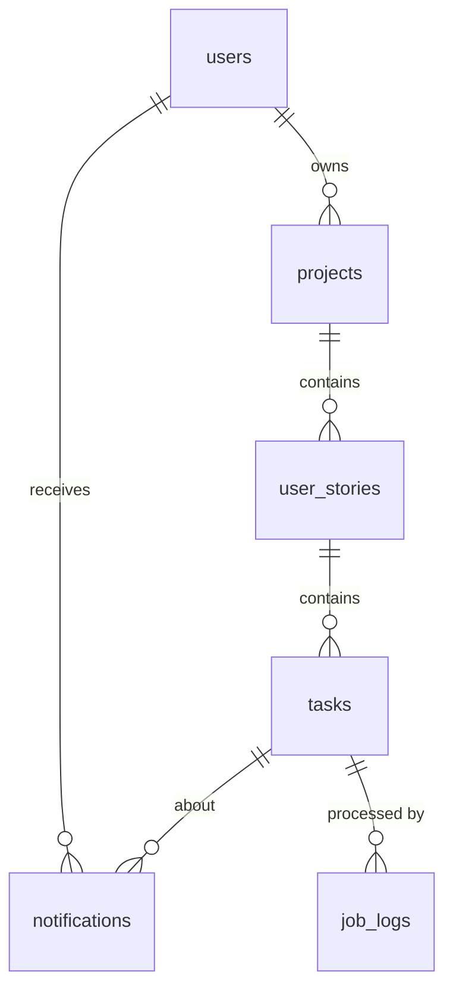

# SprintBoard: Agile Project Management Tool

A full-stack web app for small teams (3–10 people) to plan work in a simple agile hierarchy:

**Project → User Story → Task**

- Backend: FastAPI, SQLAlchemy, SQLite, JWT auth, APScheduler
- Frontend: React (Vite)
- Background workflow: overdue-task reminders with retries and a job log

> **Demo video:** _add your link here (YouTube unlisted / Google Drive / file in `docs/`)_

## Documentation

- [API documentation](docs/API.md) (plus interactive Swagger at `/docs`)
- [Database schema](docs/DATABASE_SCHEMA.md)
- [Architecture overview](docs/ARCHITECTURE.md)

## Features

- Register and log in (bcrypt-hashed passwords, JWT bearer tokens)
- Create, view, update and delete projects, user stories and tasks
- Stories have status, priority, story points and an assignee; tasks have status, assignee and due date
- Kanban-style board per project (To do / In progress / Done)
- Progress is calculated up the hierarchy: tasks done → story progress → project progress
- Story board column updates automatically from its tasks' statuses
- Background job finds overdue tasks and sends in-app reminders; job log page shows attempts and failures
- Interactive API docs at `/docs`

## Quick start

Requirements: Python 3.10+, Node 18+.

### 1. Backend

```bash
cd backend
python -m venv venv
venv\Scripts\activate            # Windows
# source venv/bin/activate       # Mac/Linux
pip install -r requirements.txt
cp .env.example .env             # Windows: copy .env.example .env  (then set SECRET_KEY)
python seed.py                   # optional demo data
uvicorn app.main:app --reload
```

The API runs at http://127.0.0.1:8000 and Swagger docs at http://127.0.0.1:8000/docs.
Settings are read from `backend/.env`. Set `SECRET_KEY` to a long random string (generate one with `python -c "import secrets;print(secrets.token_urlsafe(48))"`). If it is missing, a random key is used for that run and logins reset on restart.

Demo login after seeding: `asha@example.com` / `password123`.

### 2. Frontend

```bash
cd frontend
npm install
npm run dev
```

Open http://localhost:5173. In development Vite proxies `/api` to the backend.

### 3. Tests

```bash
cd backend
pytest
```

Tests cover auth, validation, hierarchy and progress, cascade delete, ownership rules, and the background worker (idempotency, retries, failure handling).

## Architecture

```
React (Vite)  --HTTP/JSON-->  FastAPI  --SQLAlchemy-->  SQLite
                                 |
                       APScheduler (in-process thread)
                       every 5 min: overdue check -> notifications + job_logs
```

```
backend/app/
  main.py          app setup, CORS, scheduler lifecycle
  config.py        environment-driven settings
  database.py      engine, session, SQLite foreign keys on
  models.py        SQLAlchemy tables
  schemas.py       Pydantic request/response validation
  auth.py          bcrypt, JWT, current-user dependency
  worker.py        background overdue-reminder workflow
  routers/         auth, projects (+ stories), work (stories + tasks), notifications (+ jobs)
frontend/src/
  api.js           fetch wrapper
  App.jsx          shell + hash routing
  pages.jsx        Auth, Projects, Board (+ story panel), Reminders
```

## Database schema



| Table | Columns |
|---|---|
| `users` | id, name, email (unique), password_hash, created_at |
| `projects` | id, name, description, owner_id → users (RESTRICT), created_at |
| `user_stories` | id, project_id → projects (CASCADE), title, description, status, priority, story_points, assignee_id → users (SET NULL), created_at |
| `tasks` | id, story_id → user_stories (CASCADE), title, description, status, assignee_id → users (SET NULL), due_date, created_at |
| `notifications` | id, user_id → users (CASCADE), task_id → tasks (CASCADE), kind, message, is_read, created_at |
| `job_logs` | id, job_type, task_id → tasks (SET NULL), status (pending/success/failed), attempts, error_message, created_at, finished_at |

Constraints and indexes: `status` is restricted to `todo | in_progress | done` and `priority` to `low | medium | high` by CHECK constraints; indexes on `users.email`, `(project_id, status)` for stories, `(due_date, status)` for tasks (used by the overdue query), and `notifications.user_id`. Foreign keys are enforced (`PRAGMA foreign_keys=ON` on every connection), so deleting a project cascades to its stories and tasks.

## API overview

Full interactive documentation: `/docs` (Swagger) and `/redoc`. All endpoints except register, login and `/health` need `Authorization: Bearer <token>`.

| Method | Path | Purpose |
|---|---|---|
| POST | `/api/auth/register` | Create account, returns token |
| POST | `/api/auth/login` | Form fields `username` (email) + `password`, returns token |
| GET | `/api/users`, `/api/users/me` | Team members / current user |
| GET, POST | `/api/projects` | List / create projects (with progress) |
| GET, PATCH, DELETE | `/api/projects/{id}` | Read / update / delete (delete: owner only) |
| GET, POST | `/api/projects/{id}/stories` | List / create stories in a project |
| GET, PATCH, DELETE | `/api/stories/{id}` | Read / update / delete a story |
| GET, POST | `/api/stories/{id}/tasks` | List / create tasks in a story |
| PATCH, DELETE | `/api/tasks/{id}` | Update / delete a task |
| GET | `/api/notifications` | My reminders (`?unread_only=true`) |
| POST | `/api/notifications/{id}/read` | Mark my reminder as read |
| POST | `/api/jobs/overdue-check` | Run the overdue check now (202, runs in background) |
| GET | `/api/jobs/logs` | Background job history |

Errors use standard status codes: 401 unauthenticated, 403 forbidden, 404 not found, 409 duplicate email, 422 validation.

## Async workflow: overdue-task reminders

**What it does.** Every 5 minutes (`OVERDUE_CHECK_MINUTES`), or when someone presses "Check overdue tasks now" (which returns `202` immediately and works in a FastAPI background task), the worker finds tasks that are past due, not done, and assigned. Each gets an in-app notification for its assignee.

**Failure handling and retries.**
- Every reminder gets a `job_logs` row (`pending → success | failed`) with attempt count and last error.
- Delivery is retried up to `JOB_MAX_ATTEMPTS` (3) with exponential backoff (2s, 4s, …).
- After the last failed attempt the job is marked `failed` and the error is logged; other tasks are not blocked.
- Failed tasks are picked up again on the next scheduled run, because no reminder exists for them yet that day.
- The notification and the `success` status commit in one transaction, so a crash cannot leave a half-sent reminder.
- **Idempotent:** a task gets at most one reminder per day, so overlapping or repeated runs don't spam anyone. The scheduler uses `max_instances=1` and `coalesce=True`.
- To see retries in a demo, set `DELIVERY_FAIL_RATE=0.7` and trigger the check; watch the job log page.

## Design decisions and tradeoffs

- **FastAPI + Pydantic:** validation and OpenAPI docs come from the same type definitions, so docs cannot drift from the code.
- **SQLite:** zero setup and enough for a small team. Tradeoff: one writer at a time and no horizontal scaling. SQLAlchemy lets us move to PostgreSQL by changing `DATABASE_URL` (plus adding migrations).
- **APScheduler in-process instead of Celery/Redis:** far simpler to run and review. Tradeoff: jobs die with the process and cannot scale across several server instances. With multiple instances you would need a shared queue or a leader lock.
- **Retry with `time.sleep` in the worker thread:** simple and fine for a handful of tasks. A queue with delayed retries would be better at scale.
- **Shared workspace permissions:** any logged-in user can see and edit all projects (a small trusted team). Only the project owner can delete a project. Roles and per-project membership are listed under "next".
- **Progress is computed on read** from task states instead of stored, so it can never go stale. Cost: loads tasks per project; fine at this scale (eager loading avoids N+1 queries).
- **Story status is derived from its tasks** (all tasks to do → To do; all done → Done; anything else → In progress). It is computed on every read, so it can never be stale, and cannot be edited by hand once the story has tasks (409). Stories with no tasks keep their manually set status.
- **Hash routing, no router library:** fewer dependencies for three screens.
- **create_all instead of migrations:** quick to start; Alembic is the next step for schema changes.

## Security considerations

- Passwords hashed with bcrypt (salted); never returned by the API; 8–72 character limit (bcrypt's input limit).
- JWT access tokens (HS256) with expiry; `SECRET_KEY` comes from the environment and is never committed (`.env` is git-ignored).
- Login returns one generic error and does a dummy hash check for unknown emails, to limit account enumeration and timing differences.
- All input validated by Pydantic (lengths, enums, ranges, email format); DB CHECK constraints as a second layer.
- SQLAlchemy parameterised queries prevent SQL injection; React escapes output by default (no `dangerouslySetInnerHTML`).
- CORS limited to configured origins, methods and headers.
- Object checks: notifications are only readable by their recipient (404 otherwise); project deletion is owner-only.
- Token is kept in `sessionStorage`, which limits lifetime but is readable by scripts if XSS ever occurs. Tradeoff: an httpOnly cookie plus CSRF protection would be stronger.
- **Known gaps:** no login rate limiting, no refresh tokens or revocation, no HTTPS termination (use a reverse proxy in production), no audit log.

## AI usage

_Edit this section so it is true for you._ Example: I used an AI assistant (Claude) to plan the data model, scaffold the FastAPI and React code, and draft tests and this README. I reviewed every file, ran the app and tests myself, and made changes where needed. I can explain each module, the retry logic, and the schema decisions.

## What I would improve next

1. Per-project membership and roles (owner / member / viewer) with permission checks on every endpoint
2. Alembic migrations and PostgreSQL for deployment; Dockerfile and docker-compose
3. Real delivery channels (email/Slack) behind `deliver_reminder`, plus due-soon reminders and user notification preferences
4. A proper job queue (e.g. Celery or RQ with Redis) with dead-letter handling and metrics
5. Drag-and-drop board with ordering, comments, activity history, search and filters
6. Login rate limiting, refresh-token flow, httpOnly cookie auth, password reset
7. Pagination on list endpoints, end-to-end tests (Playwright), CI with GitHub Actions
8. Sprints and burndown charts
